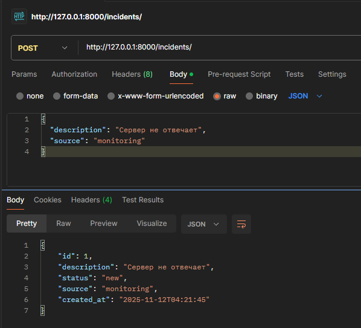
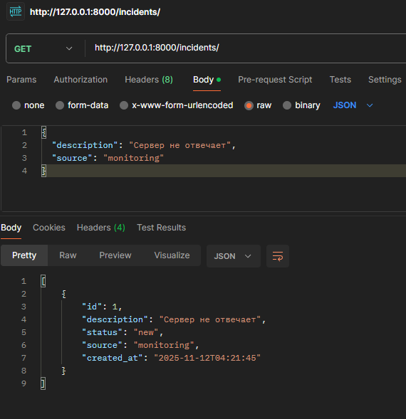
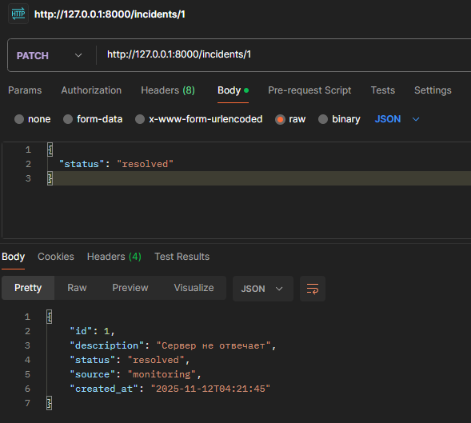
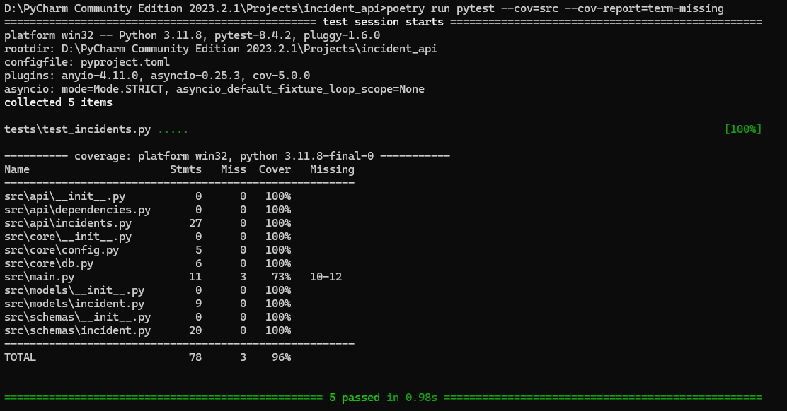

# Incident API

Простой API для работы с инцидентами.

## Запуск

1. Клонируем репозиторий:

```bash
git clone https://github.com/Mellettan/incident_api
cd incident_api
````

2. Устанавливаем зависимости через Poetry:

```bash
poetry install --no-root
```

3. Запускаем приложение:

```bash
poetry run uvicorn src.main:app --reload
```

API будет доступно по адресу: `http://127.0.0.1:8000`.

---

## Эндпоинты

### Создание инцидента

**POST** `/incidents/`



---

### Получение списка инцидентов

**GET** `/incidents/`



---

### Обновление статуса инцидента

**PATCH** `/incidents/{id}`



---
## Тестирование

Покрытие тестами - 96%. Все ключевые функции протестированы.

