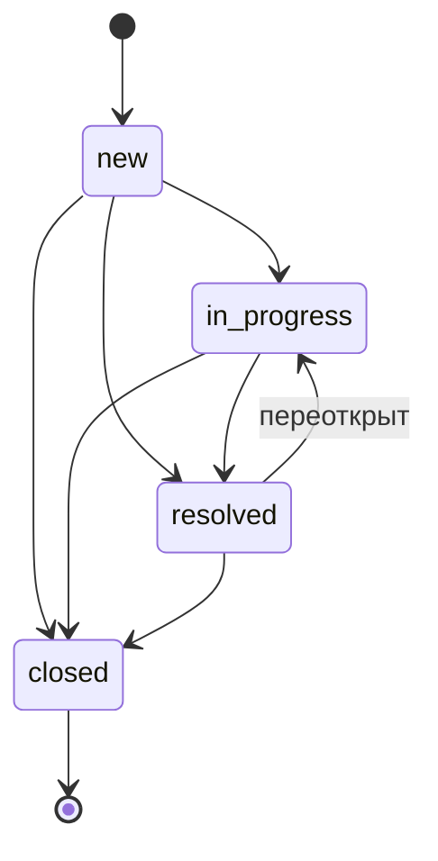

# Incident API

[](https://github.com/mellettan/incident_api/actions/workflows/ci.yml)


Сервис учёта инцидентов для операционной команды: инциденты приходят от операторов, систем мониторинга и партнёров, дальше их берут в работу, решают и закрывают. Статусы меняются только по заданным правилам, история изменений защищена от гонок.

## Возможности

- Регистрация инцидента с описанием и источником (`operator`, `monitoring`, `partner`).
- Список с фильтрами по статусу и источнику, пагинацией и общим количеством.
- Смена статуса по машине состояний, при недопустимом переходе — `409 Conflict`.
- Комментарий с решением при переводе в `resolved`.
- `/health` с проверкой соединения с БД для liveness/readiness-проб.

### Жизненный цикл инцидента



Смена статуса выполняется под `SELECT ... FOR UPDATE`: два одновременных запроса не смогут, например, одновременно закрыть и переоткрыть инцидент. Повторная установка текущего статуса идемпотентна.

## API

Swagger UI: http://localhost:8000/docs

| Метод | Путь | Описание |
|---|---|---|
| `POST` | `/incidents` | создать инцидент |
| `GET` | `/incidents?status=&source=&limit=&offset=` | список от новых к старым |
| `GET` | `/incidents/{id}` | инцидент по id |
| `PATCH` | `/incidents/{id}` | сменить статус |
| `GET` | `/health` | проверка сервиса и БД |

```bash
curl -X POST localhost:8000/incidents \
  -H 'Content-Type: application/json' \
  -d '{"description": "Самокат #1042 не выходит на связь", "source": "monitoring"}'
```

```json
{
  "id": 1,
  "description": "Самокат #1042 не выходит на связь",
  "source": "monitoring",
  "status": "new",
  "resolution": null,
  "created_at": "2025-11-13T18:02:11.513427Z",
  "updated_at": "2025-11-13T18:02:11.513427Z"
}
```

```bash
curl -X PATCH localhost:8000/incidents/1 \
  -H 'Content-Type: application/json' \
  -d '{"status": "resolved", "resolution": "Перезагружен IoT-модуль"}'

curl -X PATCH localhost:8000/incidents/1 -H 'Content-Type: application/json' -d '{"status": "new"}'
# 409 {"detail": "Нельзя перевести инцидент из статуса resolved в new"}
```

## Запуск

```bash
docker compose up --build
```

Compose поднимает PostgreSQL, применяет миграции отдельным одноразовым сервисом и только после этого стартует API.

Локально:

```bash
uv sync
docker compose up -d db
uv run alembic upgrade head
uv run uvicorn incident_api.main:create_app --factory --reload
```

## Тесты и качество

```bash
docker compose up -d db
uv run pytest
uv run ruff check . && uv run ruff format --check .
uv run mypy
```

Тесты работают с настоящим PostgreSQL (`TEST_DATABASE_URL`, по умолчанию база `incidents_test` из compose): enum-типы, блокировки строк и сортировка проверяются так же, как в проде. В CI дополнительно проверяется, что миграции применяются, совпадают с моделями (`alembic check`) и откатываются.

## Устройство

```
src/incident_api/
├── main.py            # фабрика приложения, lifespan, обработчики ошибок
├── api/
│   ├── incidents.py   # HTTP-слой
│   ├── health.py
│   └── dependencies.py
├── service.py         # бизнес-логика и правила переходов
├── repository.py      # запросы к БД
├── models.py          # SQLAlchemy-модели и машина состояний
├── schemas.py         # pydantic-схемы запросов и ответов
├── db.py              # engine, сессия на запрос
└── config.py          # настройки (pydantic-settings)
alembic/               # миграции (async)
```

Слои разделены так, что HTTP ничего не знает о SQL, а сервис — о FastAPI: доменные ошибки (`IncidentNotFoundError`, `InvalidStatusTransitionError`) переводятся в HTTP-коды в одном месте. Сессия открывается на запрос и коммитится только при успешном ответе.
